# Go Review

A local visual workbench for understanding and reviewing Go applications.
Start at an application's entry points, follow responsibilities into their
implementations, inspect source and test evidence, and compare committed changes.
The core tool needs no AI service, cloud account, Node.js runtime, or browser CDN.

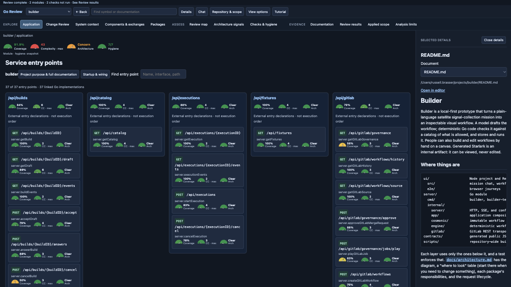

*A real Builder review: Application groups 37 HTTP registrations by route.
Select an entry to follow its implementation. The right-hand reader shows
the project's retained README; the gauges summarize collected evidence, not
an overall quality score.*

## Contents

- [Install and start](#install-and-start)
- [Choose what to collect](#choose-what-to-collect)
- [Find your way around](#find-your-way-around)
- [Explore the application](#explore-the-application)
- [Inspect a function](#inspect-a-function)
- [Assess where to investigate](#assess-where-to-investigate)
- [Read documentation and collection results](#read-documentation-and-collection-results)
- [Review committed changes](#review-committed-changes)
- [Assess unit-test quality](#assess-unit-test-quality)
- [Use the optional assistant](#use-the-optional-assistant)
- [Connect an MCP client](#connect-an-mcp-client)
- [Troubleshooting](#troubleshooting)
- [Reference and development](#reference-and-development)

## Install and start

### Prerequisites

- **Go 1.24 or newer**, plus a local Go toolchain suitable for the project you
  review and its dependencies.
- **Git** for repository discovery and committed-change comparisons.
- A **desktop browser**. The diagrams and paired readers are desktop workspaces;
  there is no small-screen layout.
- The target project's build/test prerequisites if you choose a full review.
  For remote Git inputs, configure Git's usual credentials and access.

### Build from source

```sh
git clone https://github.com/twosixlabs/go-review.git
cd go-review
go build -o ./bin/go-review ./cmd/go-review
```

The commands below assume this directory. You can instead run
`go install ./cmd/go-review` and use `go-review` from your Go binary directory
(normally `$(go env GOPATH)/bin`).

### Your first review

For a **trusted repository**, run:

```sh
./bin/go-review review /absolute/path/to/repository
```

This discovers Go modules, collects source evidence, runs checks and in-scope
tests, retains the results, and opens the browser. The terminal prints the URL
and the retained review location.

**Review executes repository code.** The default scope includes
`scripts/verify-repository.sh` when present, as well as Go tests. Those scripts,
tests, initializers and dependencies can have filesystem, network or service
side effects. Go Review is not a security sandbox.

To inspect source **without running target tests or scripts**:

```sh
./bin/go-review -dir /absolute/path/to/go/module
```

Open <http://127.0.0.1:8090>. Static analysis still runs Go tooling and may
download dependencies or write Go caches.

For documentation outside the discovered project tree, add
`-docs /absolute/path/to/documentation` to the static command. This flag is for
static exploration, not the `review` or `open` subcommands.

To start with no project selected:

```sh
./bin/go-review
```

Choose **Repository & scope**, enter a repository, and use **Review repository**,
or enter a module and choose **Analyze only**.

### Address, reopening and shutdown

```sh
# Use a different loopback port. Subcommand flags precede the path.
./bin/go-review review -addr 127.0.0.1:8091 /absolute/path/to/repository

# Reopen the path printed by a previous review without rerunning it.
./bin/go-review open /absolute/path/to/run/review.json
```

Keep the terminal process running while using the browser; Ctrl-C stops it.
Only loopback IP addresses are accepted. Do not expose snapshots or source
evidence through an external proxy without reviewing what they contain.

## Choose what to collect

| Action | Use it for | What runs |
|---|---|---|
| **Review repository** / `review` | Whole-repository review, including multiple Go modules | Static analysis, checks, in-scope Go tests with statement coverage, and the conventional verification script when enabled |
| **Analyze only** / `-dir` | Source exploration of one module | Go tooling and static analysis; no target tests or repository scripts |
| **Open retained review** / `open` | Continue inspecting existing results | Reads retained evidence; no new analysis or test execution |
| **Change Review collection** | Compare committed Before/After revisions | Isolated static analysis of each side; no target tests, hooks, generators or verification scripts |
| **Collect selected unit tests** | Obtain fresh evidence for exact tests | Explicitly selected top-level tests, optionally with a standard Go execution trace |

A failed check does not discard the rest of the review. Watch the progress panel,
then open **Review results** for failed, skipped and unavailable stages. A
processed stage is not necessarily a passing stage.

### Configure review scope

Before collecting a large repository, open **Repository & scope → Review scope**:

1. Enter the repository directory and choose **Load saved scope**.
2. Set repository-relative excluded paths, test-name exclusions, or exact unit
   selections.
3. Decide whether to include `scripts/verify-repository.sh`.
4. Choose **Save scope**, then start the review.

Example excluded paths, one per line:

```text
tools/experimental
**/smoke_test.go
```

Test exclusions are Go regular expressions against top-level names, for example
`^TestPerformance`. Exact selections use this form, one package per line:

```text
example.com/project/internal/service::TestCreate,TestReject
```

Leave selections empty to run all in-scope tests during Review. Generated source
is automatically excluded from review measurements but remains available for
type/build resolution. Exclusions do not constrain commands inside the
repository's own verification script.

Scope is saved on this machine, outside the checkout. It affects **future**
collections; **Evidence → Applied scope** shows what an existing result actually
used. [Detailed scope rules](docs/reference.md#review-scope).

### Where results live

Current repository review evidence is stored under the OS user cache in
`go-review/runs`; saved scope is under the OS user configuration directory in
`go-review/scopes`. These are outside the reviewed checkout.

There is **one current review per repository**, not a permanent run history.
A completed replacement prunes superseded evidence. Analyze only does not
preserve old execution measurements as though they belonged to its new snapshot.
Change Review has its own current comparison and evidence-bound local progress.
Explicit AI test-quality assessments retain independent source/evidence copies
under `go-review/test-quality` in the OS user cache. Replacing the current review
does not delete these saved assessments.

## Find your way around

The toolbar and three navigation groups stay available as you explore:

| Area | Purpose |
|---|---|
| **Module picker** | Select a retained Go module in a multi-module review |
| **Back** and breadcrumbs | Return to your previous context or a named ancestor |
| **Find symbol or documentation** | Search names, receiver methods, source text and collected documents |
| **Explore** | Application entries, committed changes, architecture, and package structure |
| **Assess** | Compare measurements, assess unit-test quality with optional AI, inspect architecture findings, and read check diagnostics |
| **Evidence** | Read documentation, collection results, applied exclusions and analysis limits |
| **Function views** | Logical flow, Control flow, Data flow and Call relationships for a selected function |
| **Details** | Open or close selected evidence; documents and diagnostics use a wider reader |
| **Repository & scope** | Change collection inputs and saved policy |
| **View options** | Display options, test-evidence collection and coverage import |
| **Tutorial** | Replay a walkthrough for the current view without executing project code |

Most structural views have **an explorer on the left, a diagram in the center,
and selected evidence on the right**. Application starts with entry cards;
documents and source open readers rather than replacing evidence with live files.

**Select is not Expand or Focus.** Selecting inspects the item. **Expand** reveals
children in place; **Focus flow** enters a responsibility's own flow. Use Back
to recover the previous selection and view.

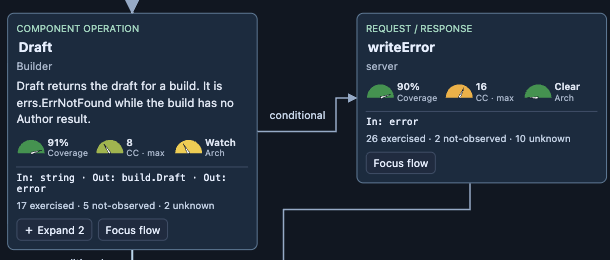

*On this Builder flow, **Expand 2** reveals Draft's two child stages in place;
**Focus flow** follows Draft separately. The conditional arrow leads to an
error alternative.*

### Diagram controls

- Scroll to pan; Shift-scroll or trackpad pinch to zoom.
- Drag the background to pan; drag a node to rearrange it.
- Use **Fit** / **Fit overview** to see the diagram's extent, then zoom into
  readable detail. A large graph is not meant to be read all at once.
- Focus a node and press Alt+arrow to move it; add Shift for larger steps.
- **Reset layout** restores automatic node positions.
- Review-map points stay at their measured coordinates and are not draggable.

Arrows have **view-specific meanings**. An import dependency, a possible next
statement and an SSA operand use are different relationships. Read the legend
above the diagram rather than treating every arrow as runtime sequence.

### Read the gauges

| Gauge | How to interpret it |
|---|---|
| **Coverage** | Matching statement coverage, weighted by statement counts; `?` or gray means unknown, not measured zero |
| **Complexity / CC** | Cyclomatic complexity; group cards show the maximum represented definition, not a sum of repeated calls |
| **Architecture** | Findings from supported source-analysis rules; inspect the finding before drawing conclusions |
| **Hygiene** | Collected check outcomes at snapshot scope, not a per-function test-quality score |

Hover or focus a gauge for its scope. Green coverage does not establish useful
assertions, all branches, or production correctness. Missing evidence is not a
failed test. [Measurement details](docs/reference.md#coverage-interpretation).

## Explore the application

### Application: start with an entry point

Choose **Explore → Application**. Depending on the module, entries are supported
HTTP registrations, CLI `main` functions, WIT component exports, or public
library functions/methods. **Startup & wiring** exposes supporting `main`/`init`
context; **Entry declaration & evidence** shows where an entry came from.

For the Builder example above:

1. Find **GET `/api/builds/{buildID}/draft`**.
2. Select the entry to open its source-backed flow.
3. Select **Draft** to inspect evidence; use **Expand** for its nested operations
   or **Focus flow** to follow that responsibility separately.
4. Inspect the error alternative and follow the source when you need exact logic.

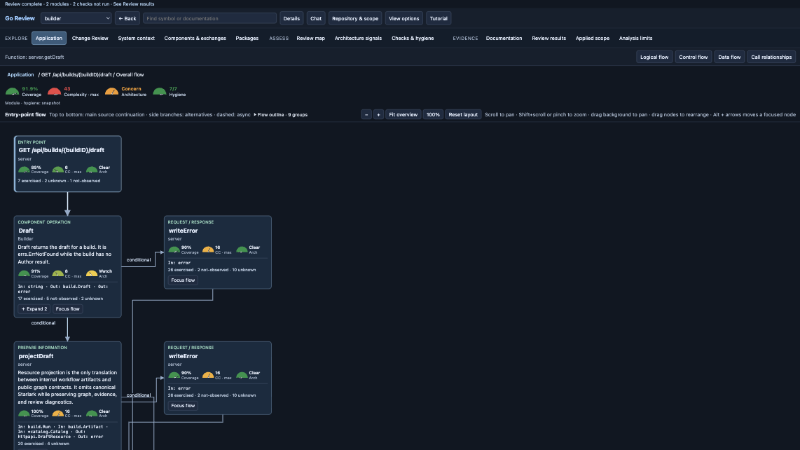

*The draft endpoint continues downward through Draft and projectDraft, with
conditional writeError alternatives to the side. The view preserves application
context instead of expanding every reachable helper. Pan down to continue;
Fit overview shows the whole flow.*

These are **possible source continuations**, not a recording of one request.
Dashed async/inspection links do not establish goroutine scheduling or callback
execution. Hidden helpers remain accessible through expansion and function views.
HTTP registration discovery does not prove a route is mounted in a running
server. [Supported entry discovery](docs/reference.md#entry-point-discovery).

### System context and Components & exchanges

Use **System context** to orient yourself among broad capabilities and external
boundaries. Then choose **Components & exchanges**, select a component group,
and select a component to inspect its operations and typed information exchanges.

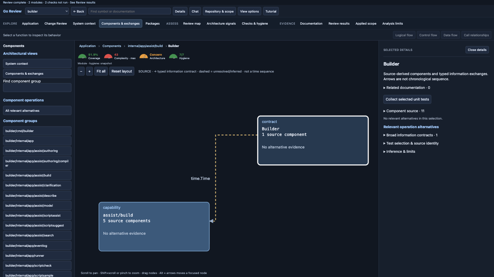

*Builder's build capability has source-derived neighbours and explicit boundary
nodes. Select a component to inspect its operations and contracts. An exchange
describes a supported information relationship, not chronological execution.*

Coverage can support inference about exercised alternatives; unknown and
not-observed alternatives remain distinct. Runtime evidence, when collected,
can add concurrency observations without turning this into a full call timeline.

[See the System context screenshot](docs/images/system-context-builder.png) for
Builder's HTTP clients, application boundary and dependency contracts.

### Packages: navigate implementation structure

Choose **Explore → Packages** to see imports between packages. Select a package,
filter its functions in the explorer, and open a function. Cross-package calls
then lead you to implementations without requiring the whole call graph.

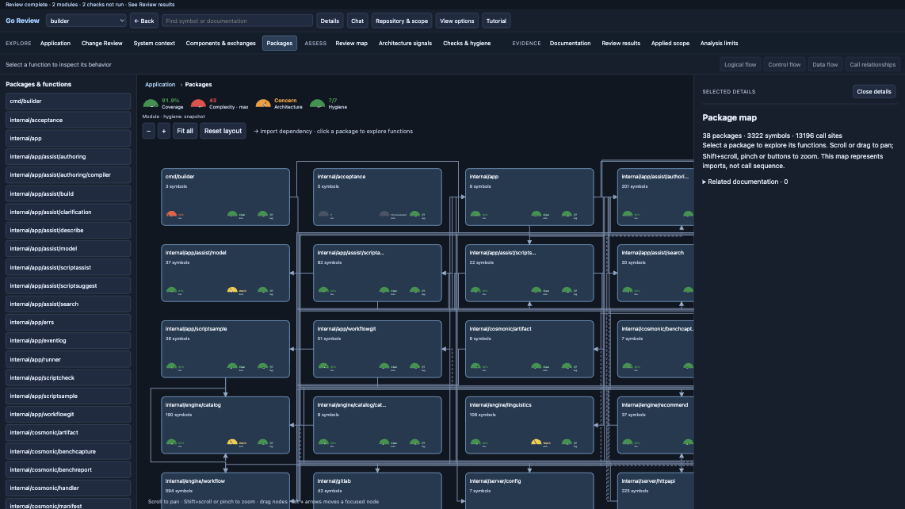

*Package arrows mean import dependencies. This is useful for finding ownership
and coupling; it is not the application's request flow. Large maps start at a
readable scale—pan to explore or use Fit all for the extent.*

## Inspect a function

To reproduce these examples, search for **getDraft** in Builder and select
**internal/server/httpapi · server.getDraft**. Opening a function starts in
Logical flow. The function-view buttons preserve the selected function.
They are disabled when no eligible function is selected; Control flow also
requires an available source graph.

### Logical flow — what implementations does this function depend on?

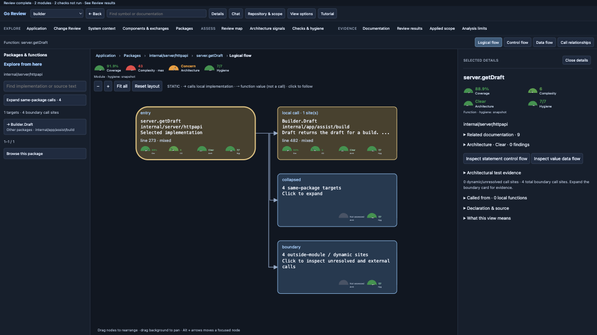

The entry card is the selected function. Follow **Builder.Draft** into its
implementation; expand the **same-package calls** card for supporting local
targets. Boundary cards retain external/dynamic call sites instead of inventing
local implementations.

Solid arrows are calls; dashed reference links represent function values,
registrations or callbacks—not proof that they executed. Use the details pane
to read exact call/reference sites, documentation, and source.

### Control flow — where can execution branch or return?

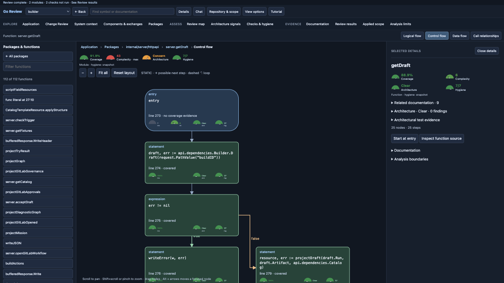

Read from entry through statements and decision successors. In this example,
the Draft call is followed by `err != nil`, with separate error and normal
continuations. Select a step to inspect its source, comments and matching
coverage. **Group simple steps** in View options changes statement grouping;
it does not make a block atomic.

Colors describe retained coverage on matching source regions. They do not prove
which complete path one test followed. Loops, panic/recovery, indirect calls and
missing graphs retain their stated limitations.

### Data flow — where is a value defined and directly used?

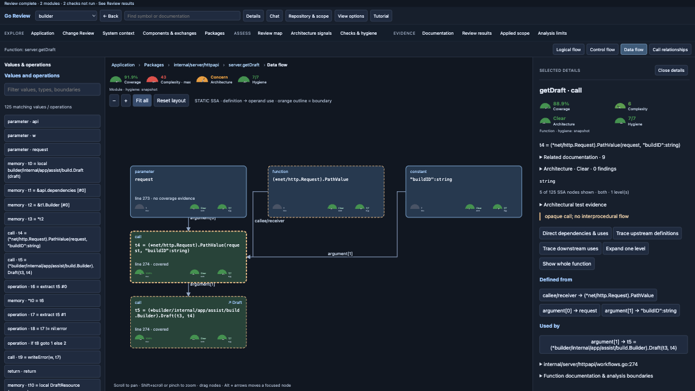

Select a value or instruction in the explorer, then choose **Direct dependencies
& uses**, **Trace upstream definitions**, or **Trace downstream uses**.
**Expand one level** grows the slice; **Show whole function** broadens its scope.

Here, the value from `request.PathValue("buildID")` feeds the Draft call.
Arrows connect SSA definitions to direct operand uses, **not execution order**.
Orange/dashed call boundaries do not infer argument-to-return propagation.
Memory, aliases, channels and external calls are not a complete lineage model;
no runtime values are captured.

### Call relationships — who calls this function, and what does it call?

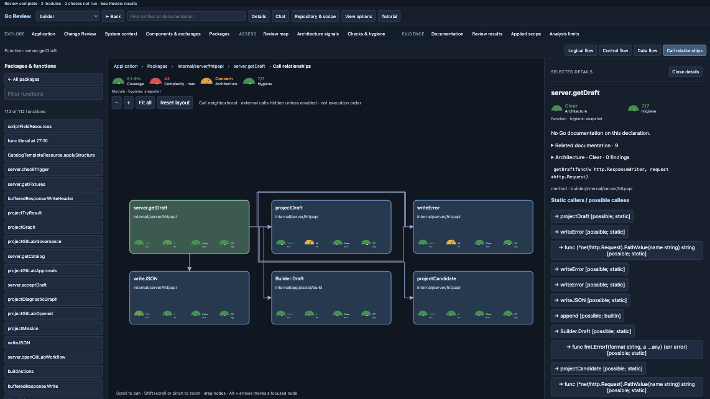

Use this view for the caller/callee neighbourhood, including cross-package
navigation. Select a relationship for its retained source site and resolution.
It answers a structural question; use Control flow for statement progression
and Application for entry-point context.

## Assess where to investigate

### Review map

Choose **Assess → Review map** to compare functions using two measurements.

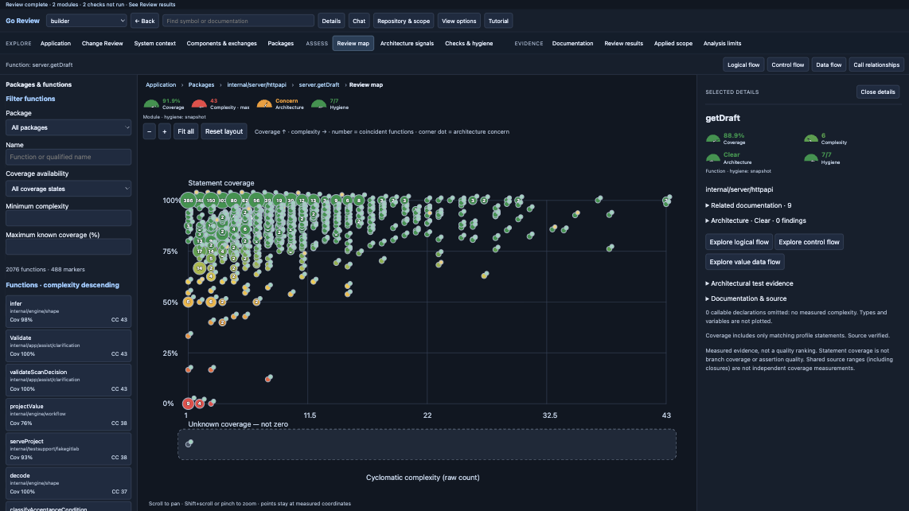

- **Right** means higher raw cyclomatic complexity; **up** means greater known
  statement coverage.
- The gray **Unknown coverage—not zero** band is separate from measured 0%.
- A numbered marker contains functions with identical measurements; select it
  to choose a member.
- Filter by package/name or measurement ranges, then open a selected function's
  Logical flow, Control flow or Data flow.

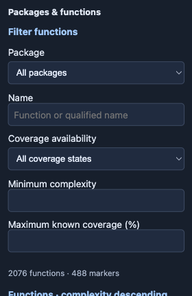

*Use these filters to narrow the plotted functions. Coverage availability can
separate functions with known measurements from those without them.*

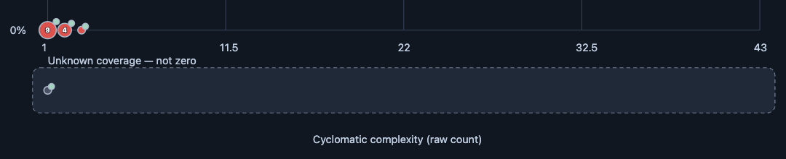

*The red markers on the 0% line have measured zero coverage; the gray band
below holds functions whose coverage is unknown.*

Use the map to choose an investigation, not to rank developer performance.
High complexity plus low coverage is a lead to inspect, not a correctness verdict.

### Architecture signals and Checks & hygiene

**Architecture signals** groups supported rule findings. Select a finding to
read its rule, source evidence and location, then follow that location into code.
**Checks & hygiene** shows formatting, syntax/type and other collected check
outcomes; select a check to read diagnostics.

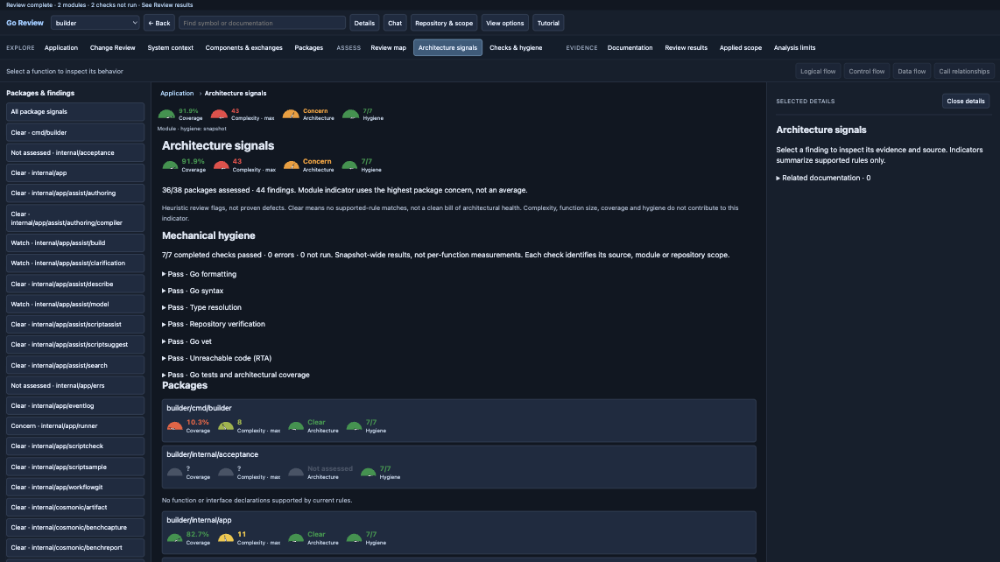

*Findings are inspectable evidence with scope and limitations, not an opaque
AI-generated risk score. Check the underlying rule and source before deciding
whether a concern matters to this application.*

[See the Checks & hygiene screenshot](docs/images/checks-builder.png) for the
seven completed server checks and their expandable diagnostic rows.

## Read documentation and collection results

**Evidence → Documentation** opens collected Markdown in a wide reader.
Select a document or search for it; **Related documentation** links in code
details explain textual associations. These links do not certify a document's
accuracy or currency. **Open in editor** opens the attributable source location.

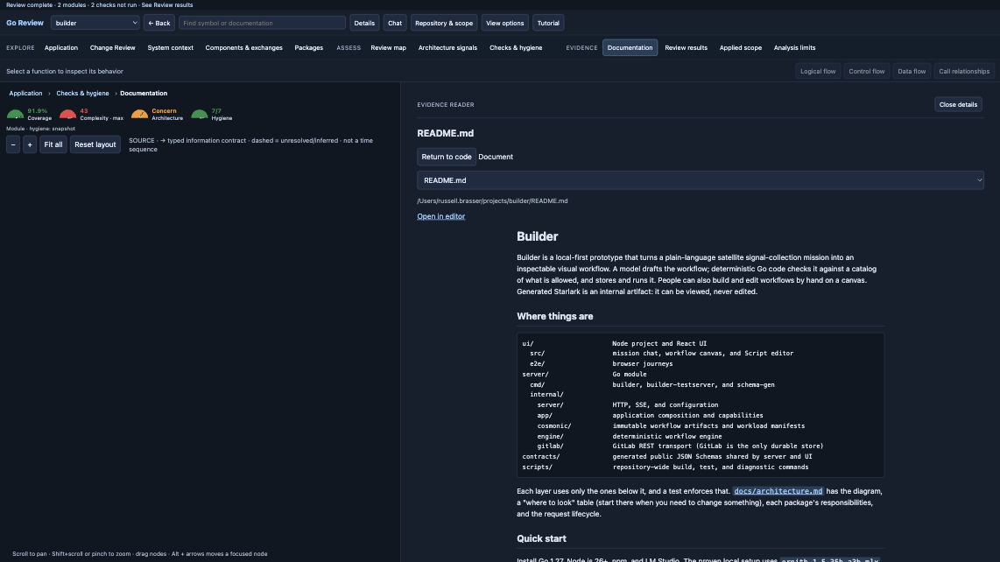

**Review results** shows the repository run, modules, stages and retained command
output. Open a failed or skipped stage to find what happened, rather than
assuming a missing measurement means success. **Applied scope** shows exclusions;
**Analysis limits** shows provenance, warnings and unsupported surfaces.

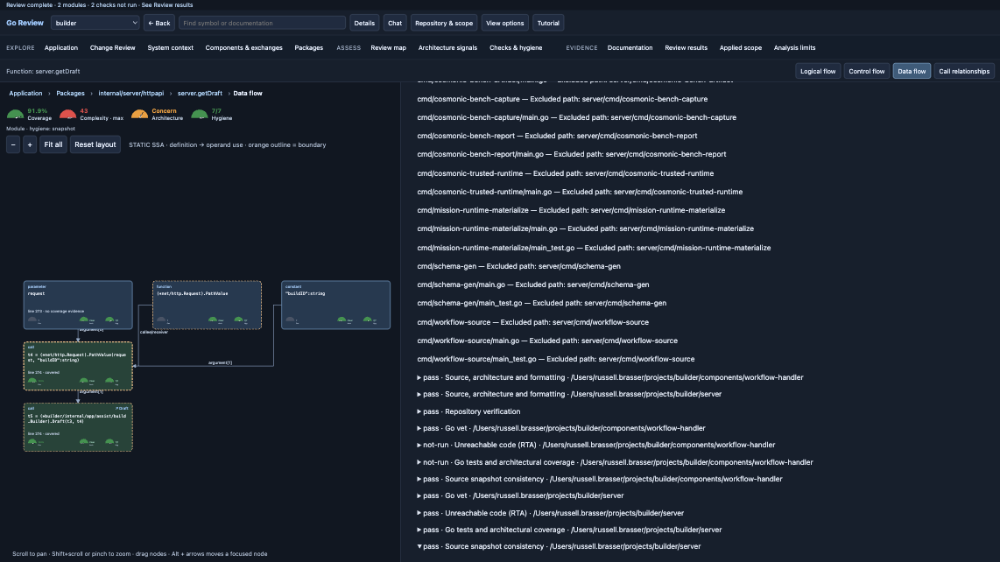

*Scroll within Review results to see stage outcomes. Here the server stages
passed, while two component stages were not run. Browsing results does not rerun
checks. Applied exclusions describe collection-time policy, not whatever scope
you have saved since.*

### Collect or import focused test evidence

Open **View options → Collect or import test evidence**:

- **Collect selected unit tests** opens package and exact test-name inputs.
  Review the execution warning, optionally include a standard Go runtime trace,
  then explicitly start collection. Supporting initialization and `TestMain`
  can still execute. This refreshes the selected module's evidence.
- **Import coverage** reads an existing standard Go coverage profile. It does
  not run tests, and its source freshness is unverified.

The relevant component details also expose **Collect selected unit tests**.
Collected coverage supports inference about exercised source alternatives.
Optional traces add scheduler/concurrency observations, not exhaustive
function-call order or runtime value lineage.
[Coverage and trace limitations](docs/reference.md#control-flow-is-not-observed-execution).

## Review committed changes

**Explore → Change Review** is independent of the current Application selection.
It is a local reviewer aid, not a PR/MR approval or merge workflow.

1. Choose **Compare Git revisions** and enter a repository.
2. Enter a local target branch or commit in **Before / target** and a source
   branch or commit in **After / source**. If the source is on another remote or
   fork, enter its Git remote name or repository URL in **Source Git remote**.
3. Check **Compare from merge base** to review changes introduced by the source
   branch. Leave it unchecked to compare the two exact commits. Choose
   **Resolve revisions** and inspect the pinned commits.
4. Confirm **Collect these pinned revisions**. Static tooling may prepare Go
   exports and download dependencies; target tests/scripts do not run.
5. Start with **Affected flows**, select a changed responsibility, and compare
   its retained evidence.

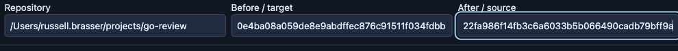

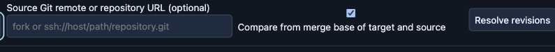

*Enter the repository and revisions first; use the optional remote for a source
on another Git repository. The merge-base checkbox controls the comparison
starting point. Resolving previews the pinned revisions; it does not collect
them until you confirm.*

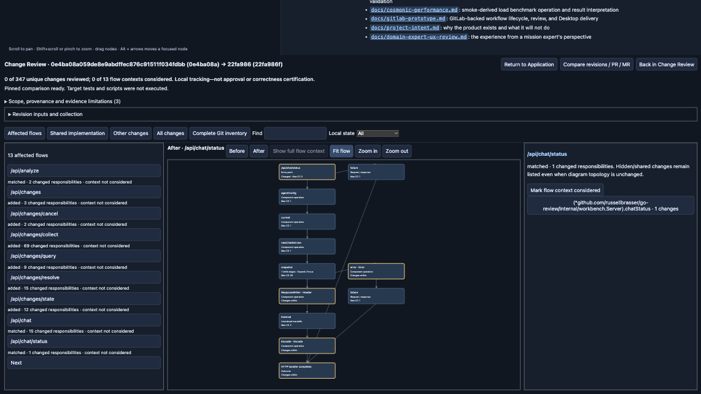

*Go Review reviewing its own Change Review implementation, from `0e4ba08` to
`22fa986`, with `/api/chat/status` selected. Flow associations explain
source-supported potential impact. They do not establish changed runtime
behaviour.*

| Perspective | What to use it for |
|---|---|
| **Affected flows** | Find entries with source-backed associations to changed material |
| **Shared implementation** | Review one implementation used by several affected flows |
| **Other changes** | Inspect supporting or unassociated changes |
| **All changes** | Browse semantic and supporting responsibility records together |
| **Complete Git inventory** | Account for every changed file, including unsupported or excluded content |

**Before / After** switches revision context. **Changes within** means a changed
implementation is inside the represented responsibility, even if its visible
topology is unchanged. Open inclusion witnesses to inspect why a flow is
associated. Ambiguous correspondence and failed analysis are not proof of
addition/removal.

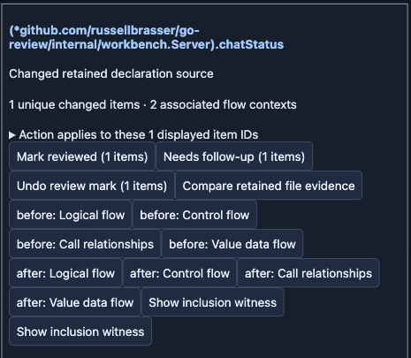

*Select a responsibility to compare its retained file, open a function view on
either revision, or inspect an inclusion witness. Review marks are explicit
local actions, separate from browsing.*

Choose **Compare retained file evidence** or **Read retained before/after** to
open a side-by-side, line-numbered diff of the complete retained files. Red
marks removed lines; green marks additions. Replacement lines are aligned,
and Go and several other supported languages have syntax coloring. Scroll the
shared view vertically to follow both revisions; long lines can be scrolled
within their cells. The reader uses committed source, not the current checkout.

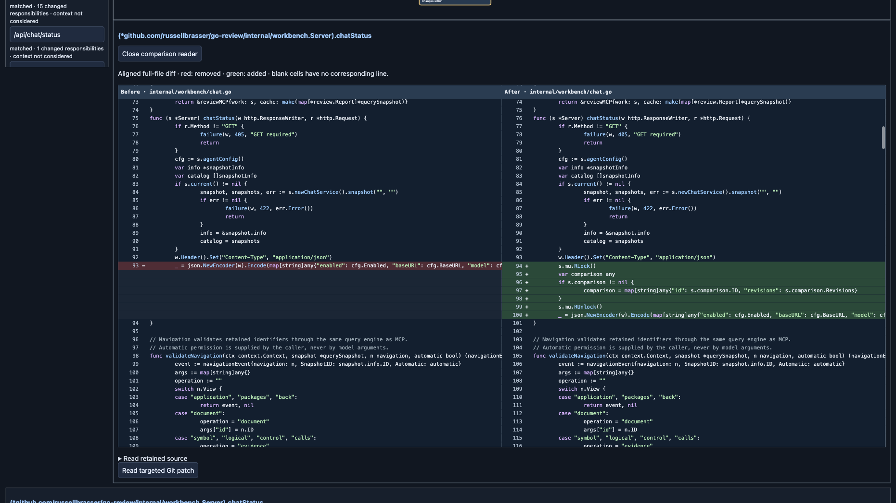

*The `chatStatus` comparison shows a removed line in Before and the replacement
and additions in After. Line numbers and syntax coloring help locate and read
the changes; blank cells keep the surrounding lines aligned.*

The diff requires complete text on both sides (an absent file is shown as
absent). When source is unavailable or the comparison exceeds the display
limits, the reader explains why instead of presenting a partial diff. Expand
**Read retained source** for independently paged source, or select **Read
targeted Git patch** for the retained patch. Deleted source remains available
on Before.

**Local state has two independent meanings:** unique changed items can be marked
reviewed or needing follow-up, and each affected flow context can be marked
considered. Browsing never changes progress. Reviewing a shared helper does not
automatically consider its callers. Actions show their exact item set and require
confirmation; another tab's updates cannot silently be overwritten.

Before must be available locally. With a remote supplied, Go Review fetches
After into temporary tool-owned storage using Git's existing credentials; the
remote may be the target repository or a fork. Fetching a hash depends on the
remote server allowing it; a branch or full ref may be needed instead. The
optional merge-base comparison shows the target tip separately and requires
unambiguous common history. Without that option the exact commits are compared.
The checkout is not modified, and no host-specific CLI or API is used.
No approvals, comments, assignments or statuses are published.
Binary, symlink, submodule, LFS-pointer and oversized items remain inventoried
with explicit evidence limits. [Change Review reference](docs/reference.md#change-review).

## Assess unit-test quality

Choose **Assess → Test Quality**, then **Start project assessment**. This uses
the [configured assistant provider](#configure-a-model) to review retained
production source, actual test assertions, helpers/mocks, relevant input cases,
control/data flow and recorded statement coverage. An external provider requires
explicit approval to send this evidence. Assessment does not execute target
tests, run the application, edit files or automatically collect newer evidence.

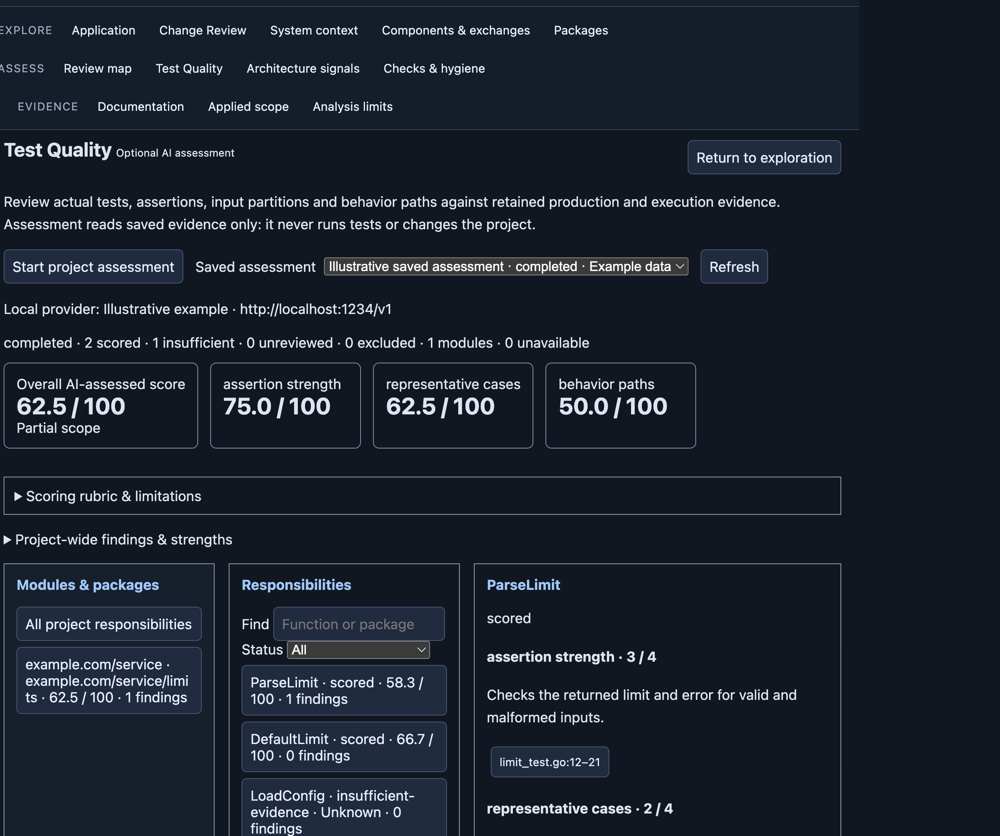

*Illustrative example data, not a real model assessment.* Use **Start project
assessment** to launch a review, and the saved-assessment selector to reopen
results. The score cards and scope counts distinguish partial results from
fully assessed functions.

The assessment runs in the background. Continue exploring or chatting; return
through **Test Quality** to monitor progress or **Cancel assessment**. Closing
the browser does not cancel the job while Go Review remains running. Shutdown
cancels active work and retains completed results; an interrupted assessment is
not silently restarted.

The displayed **AI-assessed score** is not measured coverage or a correctness
certification. Its visible rubric rates assertion strength, representative
cases, and behavior/path testing from 0–4. A function's score is 25 times its
mean applicable rating; the project score equally weights scored functions.
Insufficient and unreviewed evidence are **unknown, not zero**. Scope counts
always accompany the score, including partial assessments.

Browse modules/packages, functions and findings, then open cited production
and test lines to inspect individual cases and assertions. Statement blocks,
test-run scope and behavior evidence are available alongside the judgment.
Aggregate coverage does not identify which individual case exercised a path.

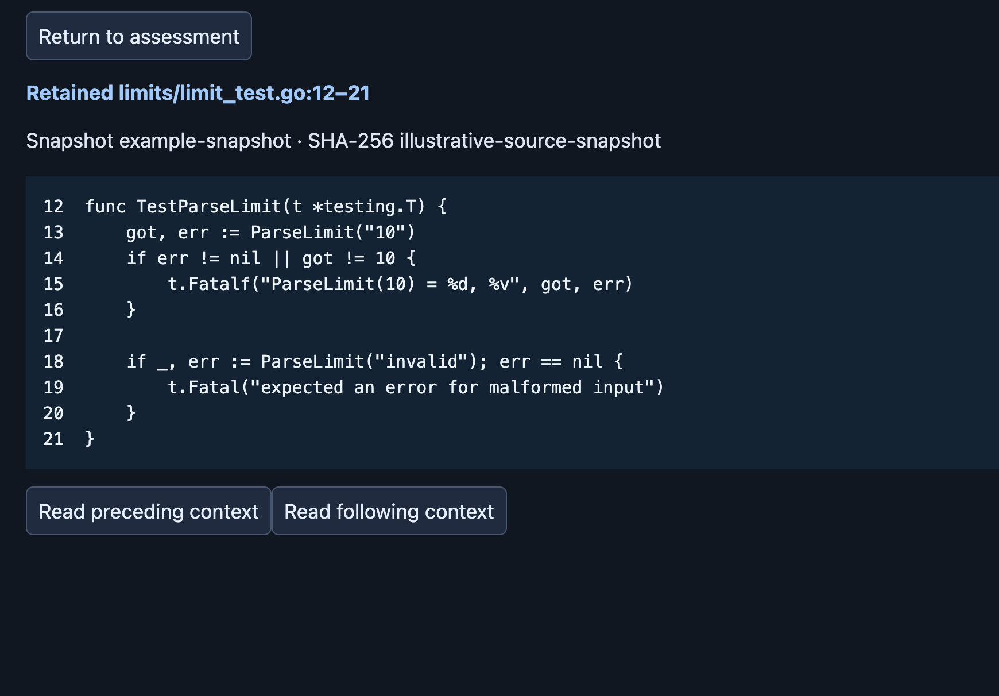

Select a citation beside a rating or finding to open the pinned source; use
**Read preceding context** and **Read following context** to inspect nearby lines.
Saved assessments reopen from their pinned evidence without a model call or
the original checkout. Chat and `review_test_quality` expose the same saved
results. [Test Quality reference](docs/reference.md#ai-test-quality).

## Use the optional assistant

The **Chat** button opens an assistant backed by the same retained evidence as
MCP. It can help investigate the project, explain the current view, navigate to
supporting evidence, and assist with a committed-change review. It is optional;
the workbench works without it.

### Configure a model

Create `agent.json` in your machine-local configuration directory:

| OS | Path |
|---|---|
| macOS | `~/Library/Application Support/go-review/agent.json` |
| Linux | `$XDG_CONFIG_HOME/go-review/agent.json`, normally `~/.config/go-review/agent.json` |
| Windows | `%AppData%/go-review/agent.json` |

Example for a local OpenAI-compatible server:

```json
{
  "enabled": true,
  "baseURL": "http://127.0.0.1:1235/v1",
  "model": "your-tool-capable-model"
}
```

Use the actual server URL and model identifier. The model must support native
function-tool calling. Restart Go Review after changing configuration.
Missing configuration or `"enabled": false` disables the assistant.

For an authenticated external provider:

```json
{
  "enabled": true,
  "baseURL": "https://your-provider.example/v1",
  "model": "your-tool-capable-model",
  "apiKeyEnv": "GO_REVIEW_API_KEY"
}
```

Set the named environment variable in the process launching Go Review.
Do not put credentials in the reviewed repository.
**An external provider receives your questions, UI context and requested source
evidence.** Review **Provider & privacy** before sending. Opening the workbench
alone does not send project evidence to a model.

### Investigate with chat

Open a collected review or a Change Review comparison, then select **Chat**.
The assistant starts with the selected module, view and item as context; it can
also query evidence from other retained modules. Ask about a specific task or
concern, then follow up as you inspect the result.

| Goal | Example request | Evidence or action |
|---|---|---|
| Understand the application | “What does this project do, and how does a request reach its main responsibilities?” | Project documentation, entry points and application flows |
| Trace behavior | “Explain this endpoint's error paths and show me the relevant control flow.” | Source-backed continuations, alternatives and the selected function view |
| Follow dependencies | “Which callers use this helper, and where does this value go?” | Call relationships and retained SSA definitions and direct uses |
| Investigate a concern | “Why is this package marked Concern? Show the finding and its source.” | Architecture rules, findings, source and their stated limits |
| Inspect testing and checks | “What coverage and test evidence support this function? Were any checks skipped?” | Coverage provenance, retained test evidence, checks, stages and diagnostics |
| Explore a change | “Which flows are affected by this helper change? Compare Before and After and show the inclusion evidence.” | Affected flows, shared changes, witnesses, retained source and patches |
| Account for a comparison | “Show the changed files that are not associated with an affected flow.” | Complete Git inventory and other/unassociated changes |
| Navigate | “Open the review map,” “focus the Draft responsibility,” or “show this change's Before source.” | Validated navigation to the corresponding view or reader |

For example, select an Application entry, ask “Explain its error paths,” and
inspect the answer's evidence buttons. Follow up with “Show the control flow for
the handler” to open the corresponding diagram. In Change Review, select an
affected flow and ask what changed, then open a cited change or paired source.
The activity section shows the evidence operations used to answer.

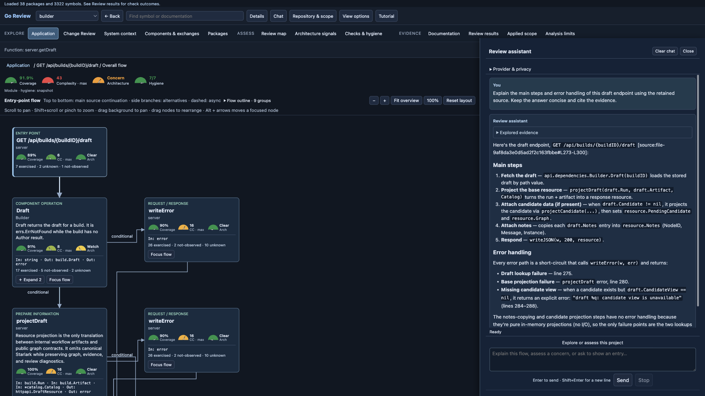

In this Builder review, the selected draft endpoint is visible beside an actual
assistant response about its steps and error paths. The answer is a starting
point for investigation, not a substitute for checking the retained source.

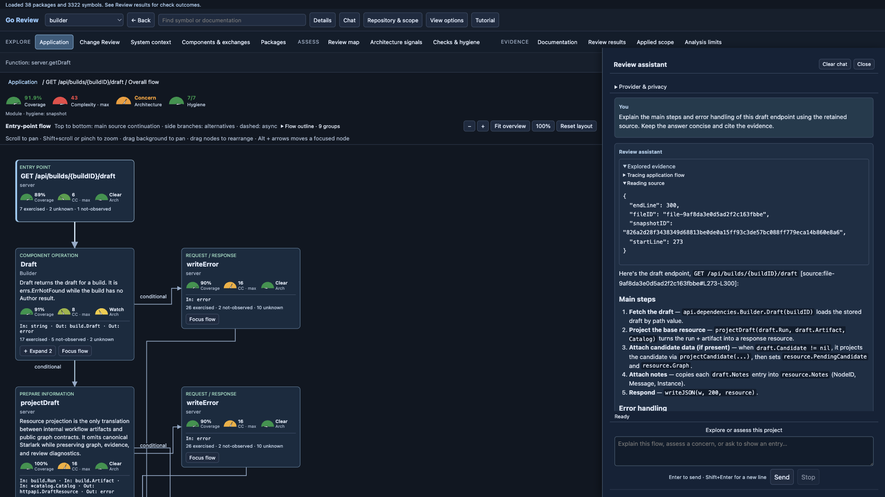

Expand **Explored evidence** and an individual operation such as **Reading
source** to see what the assistant requested. This example shows the source
file identity and line range used during the response.

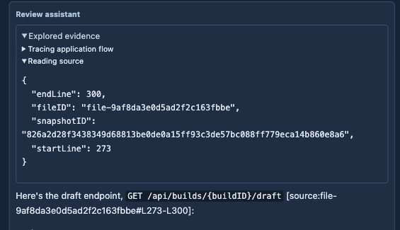

*The expanded operation identifies the retained source range the assistant
requested; inspect that evidence before relying on its interpretation.*

The assistant can propose **resolving or fetching Git revisions, collecting or
canceling a comparison, and updating local review or flow-consideration
progress**. A proposal appears as a **Review and confirm** action. Inspect its
inputs and explicitly confirm it in the host; collection also requires the
pinned-revision preview. A request to navigate does not authorize these actions.
Chat cannot start ordinary repository reviews or selected tests, change review
scope, edit source, run arbitrary commands, or publish approvals or comments.

### Navigation, evidence and privacy

Asking to **show**, **open**, **expand**, **focus** or **select** authorizes
navigation for that request; ordinary explanations leave your view alone.
The assistant may offer a **Show in diagram** button instead of moving the view
automatically. Manual movement cancels late automatic navigation. Back and
breadcrumbs retain their usual behavior.

Evidence buttons in answers and tool activity open retained source, documents,
entries or changes. Read the underlying source and limitations before relying
on an assessment: the model can misinterpret evidence, and coverage or a gauge
is not a correctness verdict. Missing coverage, unavailable analysis and
static possibilities are not proof of failure or runtime execution.

Enter sends; Shift+Enter inserts a newline. **Stop** cancels the active request.
The expandable activity section shows tool operations and progress, not private
model reasoning. **Clear chat** removes the current evidence snapshot's
browser-session history.
[Provider tuning and troubleshooting](docs/reference.md#optional-review-assistant).

## Connect an MCP client

The running workbench serves read-only Streamable HTTP MCP at
<http://127.0.0.1:8090/mcp>. In VS Code, add this to your MCP configuration
(for example `.vscode/mcp.json`):

```json
{
  "servers": {
    "go-review": {
      "type": "http",
      "url": "http://127.0.0.1:8090/mcp"
    }
  }
}
```

Keep Go Review running, and use its configured port if different.
Start with `review_overview`, retain the returned `snapshot.id` as `snapshotID`,
then explore entries, flows, packages, documents or function evidence.

For committed changes, start `review_changes` with `{"operation":"overview"}`.
Keep its `comparisonID`; use `files`, `records`, `flows`, `witnesses`, `source`,
`patch`, `flow` and `side` operations to explore. Detailed side requests identify
the module, revision side and that side's snapshot—not the ordinary Application
snapshot. Follow returned paging offsets instead of assuming summaries contain
all evidence.

**MCP reads evidence; it does not move the browser, collect a comparison or mark
progress.** Browser movement is chat's separate `navigate_changes` action.
Stale identities are rejected, and connecting an MCP client never executes
target code. [Complete tool and query reference](docs/reference.md#mcp-exploration).

## Troubleshooting

| Symptom | What to do |
|---|---|
| Browser did not open | Use the URL printed in the terminal; default is `http://127.0.0.1:8090` |
| Address already in use | Start on another loopback port with `-addr 127.0.0.1:8091` |
| No useful entries | Check the selected module and Analysis limits; try Startup & wiring or Packages. Unsupported routers or unresolved WIT are not proof the application has no entries |
| Function-view buttons disabled | Select an eligible function from search or Packages; Control flow also needs its retained graph |
| Diagram looks too large | Pan or focus one responsibility; use Fit to orient, not to make every node simultaneously readable |
| Coverage is gray or `?` | Check whether tests ran, were excluded, or have source-matching evidence. Analyze only creates no test measurements |
| Module failed to analyze | Read Review results / Analysis limits for build, dependency or type errors; available evidence and other modules remain inspectable |
| Chat disabled or model errors | Check machine-local configuration, restart, and verify the configured model supports native tools |
| Stale snapshot/comparison error | Rediscover the current overview after evidence replacement; do not reuse old node IDs |
| Remote revision fails | Check the remote name or Git repository URL, source ref, Git credentials and fetch access. For merge-base comparisons, check that complete common history is available |
| Old retained path no longer exists | Completed reviews replace older evidence; open the current retained path rather than treating the cache as an archive |

## Reference and development

- [Detailed reference](docs/reference.md): advanced configuration, complete MCP
  queries, evidence semantics, selected tests, coverage import and developer probes.
- [Screenshot examples and provenance](docs/images/README.md): which projects,
  snapshots and interactions produced these actual screenshots.
- [Project intent](docs/project-intent.md), [constraints](docs/project-constraints.md)
  and [design](docs/design.md).

To work on Go Review itself:

```sh
go test ./...
go vet ./...
go build ./cmd/go-review

# Frontend tests require Node.js and the development dependencies.
npm ci --ignore-scripts
npm test
```

These commands test this tool, not the repository you are inspecting.
For the complete local regression workflow, including race checks:
`sh scripts/test-functional-walkthrough.sh all`.
